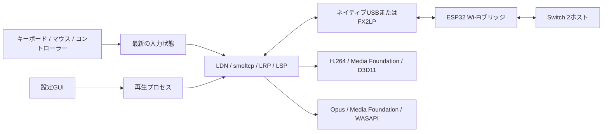

# 実装と開発ガイド

[English](DEVELOPMENT.md)

本プロジェクトへの開発参加や、別のクライアント／ブリッジ実装を検討する開発者向けの資料です。
導入と操作は[利用者向けREADME](../README.ja.md)、バイト単位の形式とセッションメッセージは[通信仕様リファレンス](PROTOCOL.ja.md)を参照してください。

## 全体構成とソースの対応

Cargoのパッケージ／ライブラリ名は`c5play`、実行ファイルとUIの名前はNS2GameShareです。
設定プロセスは別の再生プロセスを起動し、名前付きイベントで正常終了を要求します。
設定に保存するのは認証ファイルのパスであり、鍵の内容ではありません。
抽出処理の非公開出力については[パスフレーズの抽出](PASSPHRASE.md#日本語)を参照してください。



| 分野 | 主なコード |
| --- | --- |
| 設定・言語・セッションのライフサイクル | [settings.rs](../client-windows/src/settings.rs)、[設定UI](../client-windows/src/settings/ui.rs) |
| セッション全体の制御 | [connect.rs](../client-windows/src/connect.rs) |
| USBフレーム・コマンドとイベントの多重化 | [wire.rs](../client-windows/src/wire.rs)、[radio.rs](../client-windows/src/radio.rs)、[fx2.rs](../client-windows/src/fx2.rs) |
| 広告の復号と認証 | [ldn.rs](../client-windows/src/ldn.rs) |
| ユーザー空間のEthernet/IPv4/TCP/UDP | [net.rs](../client-windows/src/net.rs) |
| 制御レコードと境界検査付きFlatBuffersアクセス | [lrp.rs](../client-windows/src/lrp.rs)、[flat.rs](../client-windows/src/flat.rs) |
| メディア断片／TLVの再構成 | [lsp.rs](../client-windows/src/lsp.rs) |
| 輻輳制御と参照フレームの回復 | [quality.rs](../client-windows/src/quality.rs) |
| GPUデコードと表示 | [decoder.rs](../client-windows/src/decoder.rs)、[video.rs](../client-windows/src/video.rs) |
| 音声と任意の映像・音声同期 | [audio.rs](../client-windows/src/audio.rs)、[timeline.rs](../client-windows/src/timeline.rs) |
| 入力・割り当て用の検出・シリアライズ | [input.rs](../client-windows/src/input.rs)、[binding.rs](../client-windows/src/binding.rs)、[feedback.rs](../client-windows/src/feedback.rs) |
| DS4の代替経路とマウスのジャイロ | [ds4.rs](../client-windows/src/ds4.rs)、[mouse.rs](../client-windows/src/mouse.rs)、[motion.rs](../client-windows/src/motion.rs) |
| 共通Wi-Fiブリッジ | [firmware/main/main.c](../firmware/main/main.c) |
| Basicのパラレル転送とFX2 USBファームウェア | [fx2_fifo.c](../firmware-basic/main/fx2_fifo.c)、[FX2 main.c](../firmware-fx2/main.c) |

## ファームウェアとブリッジの分担

共通ファームウェアはESP32-C5とBasicの両ビルドで使います。
使用する転送経路は異なりますが、フレーム化されたコマンド／Ethernetのインターフェースは共通です。
Basic用ターゲットは固有のビルド設定から共通実装を組み込みます。

ステーション経路はネイティブWi-Fiのアソシエーションと内部の鍵設定に、対象チップ固有のCCMPフックを組み合わせています。
移植可能な完全な802.11スタックの実装ではありません。古い`softsta`という名前から、そのような実装と解釈しないでください。
対応するESP-IDFのバージョンは固定してください。非公開インターフェース・フレームの配置・フックは、対象チップとバージョンごとに再検証が必要です。
2.4 GHzに対応するというだけで、USB Wi-Fiアダプターや別のESP32系チップへそのまま置き換えられるとは限りません。

クライアントは参加前に新しいステーションMACアドレスを選び、デバイスのパケット番号再開に伴うCCMP nonceの再利用を軽減します。
新しい実装では、再接続をまたぐ一時鍵・送信元アドレス・パケット番号の組み合わせを考慮してください。
同じ鍵とアドレスのままパケット番号を最初から使い直すのは安全ではありません。

Wi-Fi受信コールバックはUSBを待たずに上限付きキューへコピーし、破棄時やエラー時も含めて、ドライバー所有のバッファーを必ず解放します。
転送方式を変更するときも、この所有権の扱いを維持してください。
D2Hのシーケンス番号はキューへ格納する前に進むため、デバイス内での破棄の一部をPC側から検出できます。

FX2LPはパラレルFIFOによってデバイス→PCの経路を改善しますが、逆方向には戻りUARTを使うため帯域は非対称です。
512バイトのUSB境界をまたぐフレームを保持し、未完成のフレーム内部へ整列用パディングを挿入しないでください。
電気的な制約は[配線ガイド](../firmware-basic/README.md)を参照してください。

## メディアの正確性と遅延

- フラグメント記述子より先にLSPの内部長を解析します。
  外側の8バイトのフッターを消費すると、正しい最大長パケットを拒否したり、メディアの再構成を壊したりします。
- 断片の欠落は再構成レコードを無効にします。欠番や不正データグラムを検出したら未完成レコードを破棄します。
  欠落をまたいで連結すると、一見有効に見える破損H.264ができてしまいます。
- LSPのストリーム番号とホストのLRPストリームIDは異なります。回復／QoSコマンドには映像形式通知のIDが必要です。
  IDを間違えると、ローカルのフィードバックカウンターが増えていても映像が壊れたままになることがあります。
- 受信側は現在、初期キーフレーム／参照回復を要求し、およそ500 msごとにQoSを送ります。
  回復処理は欠落したメディアのシーケンス範囲を追跡し、無効化要求の頻度を制限します。すべての欠落からの回復を保証するものではありません。
- `TransitDelay`は同期していないデバイス／PCの時計間で、移動する最小値を基準にUSB転送の余分な遅れを測ります。
  キューの滞留を示す指標であり、絶対的なネットワーク遅延や入力遅延ではありません。
- 上限付きキューと、ブロックしないメディア引き渡しを維持します。
  バッファーを増やすとアンダーランが減る一方、操作から表示までの遅延が増えます。調整時は両方の影響を記録してください。

映像経路はMedia FoundationのH.264出力をD3D11のNV12テクスチャーとして受け取り、GPUビデオプロセッサーとスワップチェーンで表示します。
デコーダーのサブリソース・可視サイズ・入力／出力の矩形・ストリーム変更時の出力型を正しく扱ってください。
確保されたテクスチャーのサイズと、表示すべき画像のサイズは同一とは限りません。ライブ経路ではCPUへの読み戻しを避けます。

音声は8バイトのラッパーを取り除き、Media FoundationでOpusをデコードし、48 kHzステレオPCMを共有モードWASAPIへ渡します。
圧縮データとPCMのキューには上限があります。音声のシーケンス欠落には現在、上限付きの無音を挿入します。
これはOpusコーデック自体のPLC／FECではありません。
任意の映像・音声同期は音声キューのタイムラインに従い、表示遅延を増やす場合があります。
入力フィードバック用の時計オフセット計算とは別の処理です。

## 入力と割り当て用の検出

コントローラーの割り当ては、現在のNintendoボタンへの変換とは独立して、生の物理入力を読みます。
接続済みで何も押されていない状態を待ってから、1個のボタン、または十字キーの上下左右の1方向への新しい押下を受け入れます。
変換後の出力と分離しないと、未割り当てのボタンを再び割り当てられなくなります。XInputのトリガーもボタンとして扱います。

DS4のUSB／Bluetoothは、DirectInput設定の下でRaw Inputの代替経路を利用できます。
WindowsのBluetoothレポートは547バイトへパディングされる場合がありますが、必要なDS4レポートはその先頭部分にあります。
Windowsバッファー全体の長さだけでなく、内部レポートの配置とCRCを検証し、割り当て用の検出とゲーム入力で同じパーサーを使ってください。
切断時とフォーカス喪失時には、押下状態を消去し、カーソルの取り込みを解除する必要があります。

### マウスのジャイロ

実験的なモデルは[nxic-pico](https://github.com/mizuyoukanao/nxic-pico)を参考にしています。
元の[MITライセンス表示](../licenses/third-party/nxic-pico-MIT.txt)を保持してください。
正確な行列と上限値は[motion.rs](../client-windows/src/motion.rs)を参照してください。

- 相対マウスカウントを目標のヨー／ピッチ角へ積分します。
  感度は仮想姿勢が1回転するカウント数であり、マウスのレポート頻度に依存する速度ではありません。
- 前回の受理されたフィードバック送信からの変化を符号化します。
  角速度に上限を設け、未送信の回転を保持することで、入力とネットワークのポーリング間でカウントを捨てないようにします。
- 重力・角速度・方向は、将来の目標姿勢ではなく実際に符号化した姿勢から求めます。
  現モデルは回転毎秒と、仮想的なオイラー角の回転量を使います。
- ピッチの上限では外向きの目標移動を捨て、逆方向へ動かしたときに見えない滞留が残らないようにします。
- リセット／解除時は、戻り回転の角速度インパルスを出さず中立姿勢にします。
- フィードバックのエンコーダーを複製し、ローカルUDPキューがパケットを受け入れた場合だけ状態を確定します。
  これによりローカルキューでの拒否時に移動量を消費しません。ただし、無線区間での到達確認ではありません。

中立時のレコードには回帰フィクスチャーがあります。
運動中のセンサー解釈・バッチ内の相対時刻・ホストの軸・ゲーム互換性・感度は実験的です。
中立状態のシリアライズ試験を、ゲーム操作の検証成功として扱わないでください。

## 検証と診断

ビルド手順とツールチェーンのバージョンは[BUILD.md](BUILD.md)を参照してください。
Rustのユニットテストは合成データや秘密情報を除いたフィクスチャーを使い、鍵や実機を必要としません。
テストは対応する実装の隣にあり、ワイヤーのCRC／パディング、LRPストリームID、LSPの境界／欠落、
フィードバックの配置、マウスカウントの不変性などを確認します。

```powershell
cargo test --locked --manifest-path client-windows/Cargo.toml
cargo fmt --manifest-path client-windows/Cargo.toml -- --check
cargo clippy --locked --manifest-path client-windows/Cargo.toml --all-targets -- -D warnings
```

主なCLIコマンドは次のとおりです。引数は`NS2GameShare.exe --help`で確認してください。

| コマンド | 用途／デバイスへの作用 |
| --- | --- |
| `diagnose <pcap>` | Ethernet pcapをオフライン解析。`--video-write`で抽出H.264を保存可能 |
| `preview <file>` | ローカルH.264 MP4の再生、GPUと入力の確認。無線セッションなし |
| `audio-self-test` | ローカル音声出力テスト。無線セッションなし |
| `controllers` | DirectInputコントローラーの列挙 |
| `fx2-status` | FX2ブリッジの識別情報／設定の読み取り |
| `link-bench --port fx2` | 基板間リンクを能動的にテスト。GameShareセッションとは別 |
| `play --ethernet-write <file> ...` | ライブセッションを開始し、非公開のEthernetキャプチャーを保存 |

ワイヤーのCRCエラー、D2Hのシーケンス欠落、LSPの欠番、不正フラグメント、ローカルのメディア破棄、
デコーダー障害、音声アンダーランを分けて調べてください。
ブリッジのベンチマークが正常でも、Wi-Fiで欠落しないことや、操作から表示までの遅延がプレイに適することまでは確認できません。

フィクスチャー／ユニットテストの結果と、USB確認、実際のゲーム操作は別々に報告してください。
通信形式を変える場合は、切り詰め・サイズ不整合・重複・シーケンスの周回／欠落の異常系も確認します。
可能なら最小の合成フィクスチャーを生成し、新しいフィクスチャーを公開する前に実際の識別子・鍵・無関係なメディアを取り除いてください。
キャプチャー、本体由来のファームウェアイメージ、抽出した秘密情報は公開ツリーの外へ置きます。
公開する資料は`public_files.py`と`.gitignore`の例外へ個別に追加し、調査資料ディレクトリ全体を許可しないでください。
[リリース確認](RELEASING.md)も参照してください。
