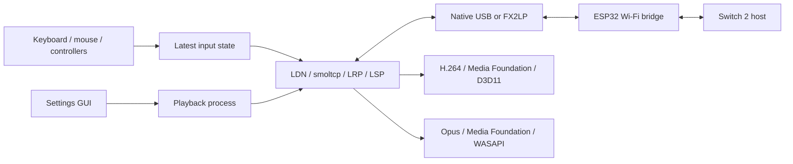

# Implementation and development guide

[日本語](DEVELOPMENT.ja.md)

This guide is for contributors and alternative client/bridge implementations.
For installation and controls, use the [user README](../README.md).
For byte layouts and session messages, use the [protocol reference](PROTOCOL.md).

## Architecture and source map

The Cargo package/library is named `c5play`; the executable and UI are NS2GameShare.
The settings process launches a separate playback process and requests graceful
shutdown through a named event. Settings contain paths to authentication files,
not the key contents. The extractor's private output is described in [PASSPHRASE.md](PASSPHRASE.md).



| Area | Entry points |
| --- | --- |
| Settings, language, session lifecycle | [settings.rs](../client-windows/src/settings.rs), [settings/](../client-windows/src/settings/ui.rs) |
| Session orchestration | [connect.rs](../client-windows/src/connect.rs) |
| USB framing and command/event multiplexing | [wire.rs](../client-windows/src/wire.rs), [radio.rs](../client-windows/src/radio.rs), [fx2.rs](../client-windows/src/fx2.rs) |
| Advertisement decryption and authentication | [ldn.rs](../client-windows/src/ldn.rs) |
| User-space Ethernet/IPv4/TCP/UDP | [net.rs](../client-windows/src/net.rs) |
| Control records and bounded FlatBuffers access | [lrp.rs](../client-windows/src/lrp.rs), [flat.rs](../client-windows/src/flat.rs) |
| Media fragment/TLV reconstruction | [lsp.rs](../client-windows/src/lsp.rs) |
| Congestion and reference recovery | [quality.rs](../client-windows/src/quality.rs) |
| GPU decoding/presentation | [decoder.rs](../client-windows/src/decoder.rs), [video.rs](../client-windows/src/video.rs) |
| Audio and optional video/audio alignment | [audio.rs](../client-windows/src/audio.rs), [timeline.rs](../client-windows/src/timeline.rs) |
| Input, capture and serialization | [input.rs](../client-windows/src/input.rs), [binding.rs](../client-windows/src/binding.rs), [feedback.rs](../client-windows/src/feedback.rs) |
| DS4 fallback and mouse gyro | [ds4.rs](../client-windows/src/ds4.rs), [mouse.rs](../client-windows/src/mouse.rs), [motion.rs](../client-windows/src/motion.rs) |
| Shared Wi-Fi bridge | [firmware/main/main.c](../firmware/main/main.c) |
| Basic parallel transport and FX2 USB firmware | [fx2_fifo.c](../firmware-basic/main/fx2_fifo.c), [FX2 main.c](../firmware-fx2/main.c) |

## Firmware and bridge boundaries

The shared firmware serves both ESP32-C5 and the Basic build. The active transport
changes, while the framed command/Ethernet interface remains common.
The Basic target includes the shared implementation through its own build configuration.

The station path uses native Wi-Fi association and internal key installation,
plus target-specific CCMP hooks. It is not a portable implementation of a complete
802.11 stack, and the older `softsta` naming should not imply otherwise.
Pin the supported ESP-IDF version: private interfaces, frame layouts and hooks must
be revalidated for each target/version. Do not assume a USB Wi-Fi adapter or another
ESP32 family is a drop-in replacement merely because it supports 2.4 GHz.

The client selects a fresh station MAC before joining to mitigate CCMP nonce reuse
when device packet numbers restart. A new implementation must account for the
temporal-key/transmitter-address/packet-number combination across reconnects;
restarting packet numbers under the same key and address is unsafe.

Wi-Fi receive callbacks copy into bounded queues without waiting for USB and always
release driver-owned buffers, including on drop/error paths. Preserve that ownership
contract when changing the transport. D2H sequence numbers advance before queue
admission, making some device-side drops visible to the PC.

FX2LP improves the device-to-PC path through a parallel FIFO. The opposite direction
still uses a return UART, so bandwidth is asymmetric. Preserve framing across 512-byte
USB boundaries; never insert alignment padding inside an unfinished wire frame.
See the [hardware guide](../firmware-basic/README.md) for electrical constraints.

## Media correctness and latency

- Parse LSP's declared inner length before fragment descriptors. Consuming the outer
  eight-byte footer can reject a valid full-size packet or corrupt media reconstruction.
- A lost fragment invalidates an assembled record. Clear partial records on a gap or
  malformed datagram; concatenating across the hole creates valid-looking corrupt H.264.
- LSP stream index and host LRP stream ID are different. Recovery/QoS commands need
  the ID from the host's video-format notice. A wrong ID can leave the picture corrupt
  even while local feedback counters increase.
- The receiver currently requests initial keyframe/reference recovery and sends QoS
  approximately every 500 ms. Recovery tracks missing media sequence ranges and
  rate-limits invalidation requests. This does not guarantee recovery from every loss.
- `TransitDelay` measures excess USB transit against a moving minimum between unrelated
  device/PC clocks. It is a queue-pressure indicator, not absolute network or input latency.
- Preserve bounded queues and nonblocking media handoff. More buffering can reduce
  underruns while increasing control-to-picture latency; record both effects when tuning.

The video path uses Media Foundation H.264 output as D3D11 NV12 textures, then a GPU
video processor and swap chain. Respect the decoder subresource, visible dimensions,
source/destination rectangles and stream-change output types. Allocated texture size
and visible image size are not interchangeable. Avoid CPU readback in the live path.

Audio strips its eight-byte wrapper, decodes Opus through Media Foundation, and feeds
48 kHz stereo PCM to shared-mode WASAPI. Compressed/PCM queues are bounded. Missing
audio sequences currently insert bounded silence; that is not codec-level Opus PLC/FEC.
The optional video/audio synchronization follows the audio queue timeline and can add
presentation latency. It is separate from the feedback clock-offset calculation.

## Input capture

Controller remapping reads raw physical input, independent of the current Nintendo
button mapping. Capture waits for a connected neutral state, then accepts a single
new button/cardinal D-pad press. Keep this separate from mapped output, or an
unassigned button cannot be assigned again. XInput triggers are treated as buttons.

DS4 USB/Bluetooth can use a Raw Input fallback under the DirectInput settings.
Windows Bluetooth reports may be padded to 547 bytes while the relevant DS4 report
occupies its prefix. Validate the embedded report layout/CRC, not only the total
Windows buffer length; use the same report parser for capture and game input.
Disconnect/focus-loss paths must clear held input and release cursor capture.

### Mouse gyro

The experimental model is adapted from [nxic-pico](https://github.com/mizuyoukanao/nxic-pico);
retain its [MIT notice](../licenses/third-party/nxic-pico-MIT.txt).
See [motion.rs](../client-windows/src/motion.rs) for the exact matrix and limits.

- Integrate relative mouse counts into target yaw/pitch angles. Sensitivity is counts
  per virtual turn, rather than a rate tied to mouse report frequency.
- Encode the change since the last accepted feedback send. Clamp angular rate and
  retain un-emitted rotation, rather than dropping counts between the input and network polls.
- Derive gravity, angular velocity and direction from the emitted pose, not a future
  target pose. The current model uses rotations/second and virtual Euler rotations.
- At the pitch stop, discard outward target movement so reversal has no hidden backlog.
- Reset/release produces neutral attitude without a return angular-velocity impulse.
- Clone the feedback encoder and commit it only if the local UDP queue accepts the
  packet. This avoids consuming motion on local queue rejection; it does not acknowledge
  delivery across the radio link.

Neutral record bytes have a regression fixture. Moving-sensor interpretation,
batch-relative time, host axes, game compatibility and sensitivity remain experimental.
Do not describe neutral serialization tests as successful gameplay validation.

## Validation and diagnostics

Build instructions and toolchain versions are in [BUILD.md](BUILD.md).
The Rust unit tests use synthetic/sanitized fixtures and require no keys or hardware.
Test names live beside the corresponding implementation, including wire CRC/padding,
LRP stream IDs, LSP boundaries/gaps, feedback layouts and mouse-count invariance.

```powershell
cargo test --locked --manifest-path client-windows/Cargo.toml
cargo fmt --manifest-path client-windows/Cargo.toml -- --check
cargo clippy --locked --manifest-path client-windows/Cargo.toml --all-targets -- -D warnings
```

Useful CLI commands (run `NS2GameShare.exe --help` for arguments):

| Command | Purpose / device effects |
| --- | --- |
| `diagnose <pcap>` | Offline Ethernet-pcap analysis; `--video-write` optionally writes extracted H.264 |
| `preview <file>` | Local H.264 MP4 playback/GPU and input checks; no radio session |
| `audio-self-test` | Local audio output test; no radio session |
| `controllers` | Enumerate DirectInput controllers |
| `fx2-status` | Read FX2 bridge identity/configuration |
| `link-bench --port fx2` | Active board-link test; separate from a GameShare session |
| `play --ethernet-write <file> ...` | Live session with a private Ethernet capture |

Separate failure domains: wire CRC errors, D2H sequence loss, LSP sequence gaps,
malformed fragments, dropped local media, decoder failures and audio underruns.
A clean bridge benchmark does not establish loss-free Wi-Fi or playable end-to-end latency.

Report fixture/unit results separately from USB checks and live gameplay. For protocol
changes, include negative cases for truncation, inconsistent sizes, duplication and
sequence wrap/gaps. Generate minimal synthetic fixtures when possible; remove real
identifiers, keys and unrelated media before publishing any new fixture.
Keep captures, firmware images from consoles and extracted secrets outside the public tree.
Add public documents explicitly to `public_files.py` and `.gitignore` exceptions;
do not allow the entire research-documents directory. See [release checks](RELEASING.md).

## 日本語の案内

[開発ガイドの日本語版](DEVELOPMENT.ja.md)と[通信仕様リファレンスの日本語版](PROTOCOL.ja.md)を参照してください。
